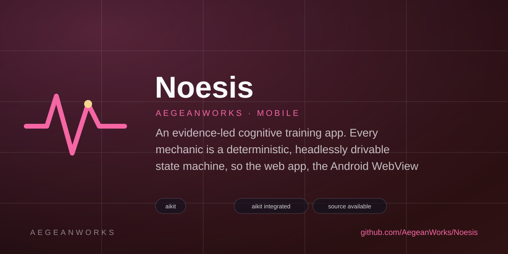
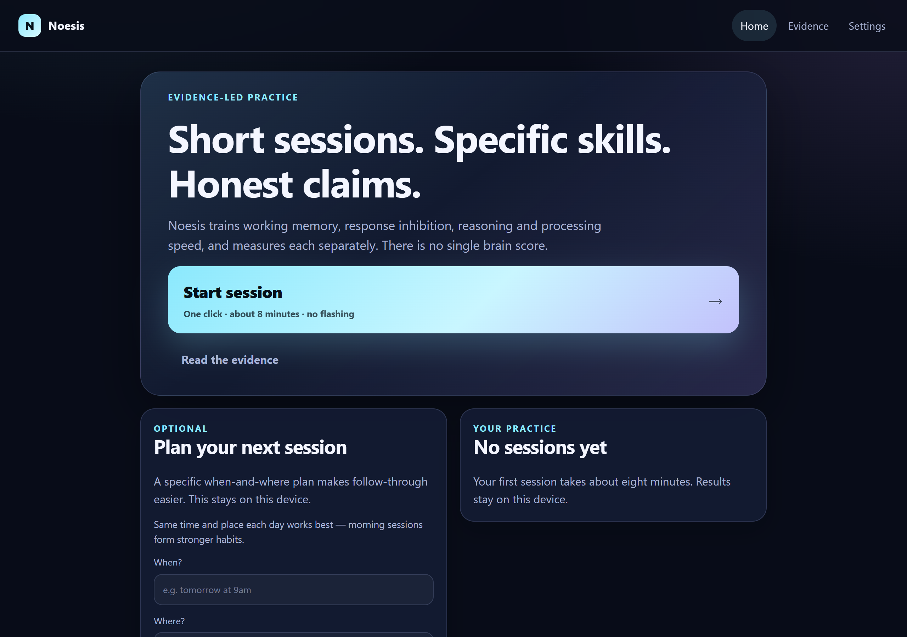
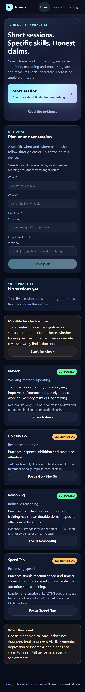
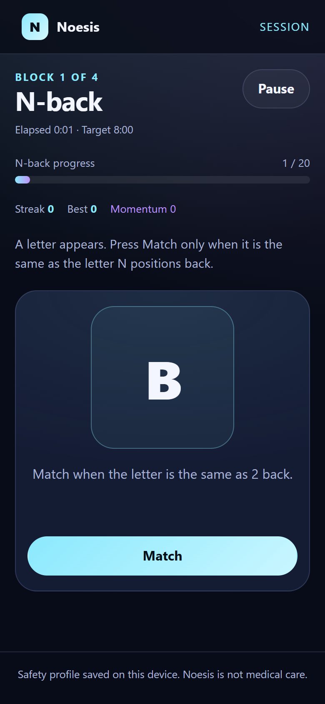
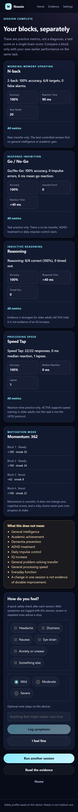
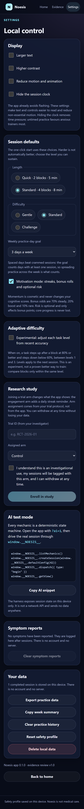
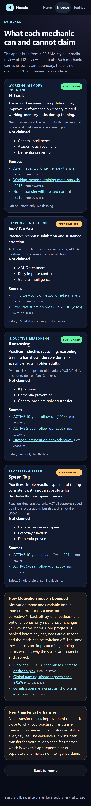

# Noesis

<!-- aegean:media:start -->
<p align="center"></p>
<p align="center"><a href="LICENSE"></a> <a href="https://github.com/AegeanWorks/AIKit"></a></p>
<!-- aegean:media:end -->


An evidence-led cognitive training app. Every mechanic is a deterministic, headlessly drivable state machine, so the web app, the Android WebView build, the test suite and AI simulators run the same logic.

**Current phase: first working vertical slice.** One-click sessions, four mechanics, local practice history, safety onboarding, per-block measurement, an evidence registry, and a debug APK build path. The evidence review that defines the claim boundaries is complete in [`docs/research/`](docs/research/).

## 30-Second Cold-Start Quick Reference

- **Runtime Prerequisites**: Node 20.19+, npm 10+, Python 3.10+, git. For the Android build: JDK 21 and Android SDK 35.
- **Install**:
  ```bash
  npm install
  ```
- **Run the web app**:
  ```bash
  npm run dev
  ```
- **Canonical Regression Shield Gate**:
  ```bash
  npm run test:all
  ```
- **Deterministic AI simulation check**:
  ```bash
  npm run ai:verify
  ```
- **Build a debug APK**:
  ```bash
  npm run android:build
  ```
  The artifact is `android/app/build/outputs/apk/debug/app-debug.apk`.

## One-Click Sessions

The home screen has one primary action: **Start session**. It creates and begins the first block in the same click. If a session is already active, the same button resumes it. First-time users answer the safety screen once; its final button also starts the session immediately.

Session length (quick or standard) and difficulty (gentle, standard or challenge) are user-selected in Settings and applied to the one-click start. The optional practice plan asks when and where the next session will happen, what to pair it with, and what to do if stuck; it is stored locally and never blocks starting.

An active session is snapshotted locally while it runs. After a browser reload or an Android WebView restart, the home screen offers **Resume session** instead of losing progress.

The home screen also shows a per-mechanic accuracy sparkline for recent sessions, a 14-day practice calendar, and caring check-ins: heavy-use patterns trigger a rest suggestion with a one-tap Motivation pause, a missed yesterday gets a no-shame nudge, and a long absence gets a welcome-back. Settings offers larger text, high contrast, reduced motion and a hideable session clock.

Completed sessions are stored locally and summarized per mechanic. Monthly word-recognition far checks, symptom reports and study enrollment (for trials) are stored separately from practice. There is no account and no server. Settings can export everything as JSON or clear it with one tap.

## Behavioral Engagement

Noesis's behavioral-psychology review is integrated as a bounded **Motivation mode** for adult and older-adult engagement:

- **Variable bonuses:** 70% steady, 20% boost, 10% rare cosmetic momentum. Odds are disclosed and capped at 100 points per block.
- **Streaks:** x1-x3 momentum multiplier based on consecutive correct trials.
- **Near-best cue:** a real +10 bonus when a block comes within 5% of your personal best.
- **Corrective near-miss:** an N-back false alarm that matches the N-1 or N+1 position gets an explanatory cue, not a reward.
- **Optional push-your-luck:** bank bonus momentum or risk it on the next block (70% accuracy threshold). Core progress is always banked first.
- **Target time:** 8 minutes standard, 5 minutes quick; no penalty for exceeding it.
- **Adopted supports:** when-where-plus-pairing-and-obstacle practice plan (all four inputs optional), adjustable weekly practice-day goal with a visual progress bar, user-selected session length and difficulty, per-mechanic practice, focus sessions and a weakest-link suggestion, per-mechanic last/best accuracy, non-punitive weekly summary, consistency calendar, milestone celebrations and personal-best highlights.

Beyond Motivation mode the product stays deliberately quieter: an **opt-in adaptive difficulty** experiment (adjusts per-task level from recent accuracy, never marketed as superior), a **monthly word-recognition far check** on its own schedule and store (the app states up front that reviews usually find no transfer), and an **opt-in research-study enrollment** that tags sessions with the assigned trial arm. A copyable weekly summary and a JSON export cover accountability and portability without accounts.

Motivation never changes cognitive scores. The mode can be switched off in Settings. There is no real money, purchasable currency, infinite loop or narrative campaign. The full audit and citations are in [docs/research/BEHAVIORAL_ENGAGEMENT.md](docs/research/BEHAVIORAL_ENGAGEMENT.md).

## AI-Testable Mechanics

Every mechanic exposes the same surface:

- a seeded RNG stored in state;
- a logical clock advanced by JSON `advance` actions, never `Date.now` inside the engine;
- JSON `respond` / `answer` actions;
- deterministic scores and a 16-character state hash;
- an action stream that replays to the same state.

Use the CLI:

```bash
npm run ai:simulate -- --mechanic nback --seed 42 --strategy optimal --json
npm run ai:simulate -- --mechanic gonogo --seed 42 --strategy random
npm run ai:simulate -- --mechanic reasoning --seed 42 --strategy never
```

Strategies: `optimal`, `random`, `always`, `never`.

In a browser, open the app with `?ai=1` and drive the real session:

```js
window.__NOESIS__.listMechanics()
window.__NOESIS__.createSession(window.__NOESIS__.defaultConfig(42))
window.__NOESIS__.dispatch({ type: "begin" })
window.__NOESIS__.getView()
window.__NOESIS__.getState()
```

`runScenario(config, actions)` evaluates a scenario without touching the live store. Invalid actions are rejected with a schema error instead of throwing.

## What the Evidence Says

The review screened 2,360 unique bibliographic records and 363 trial records, and extracted 84 reviews/RCTs with 241 outcomes.

- Cognitive training reliably improves trained tasks and short-term near transfer; broad far transfer is not established.
- Neurofeedback for ADHD shows no significant probably blinded effect; consumer-grade neurofeedback shows no cognitive benefit.
- Binaural beats may reduce anxiety and pain; cognitive enhancement is not supported.
- Exercise plus cognitive training has the most consistent small effect in older adults, but synergy is unproven.
- Photosensitive seizure risk is a hard constraint on any flashing visual content.

The app reports each block separately, avoids a composite "brain score", and states what each mechanic does **not** claim. Motivation mode is an engagement layer; it is not evidence that the app improves cognition.

## What's Inside

```text
noesis/
├── .aikit/                       <- project memory: record, ledger, decisions, codebase map
├── .gitignore                    <- transient and generated artifacts excluded
├── assets/                       <- project logo and social preview
├── android/                      <- Capacitor 7 Android project
├── docs/                         <- research and design documentation
├── docs/research/                <- protocol, search log, PRISMA flow, synthesis, design implications
│   ├── analysis/                 <- machine-readable evidence table and screening data
│   ├── records/                  <- raw PubMed, OpenAlex, trial-registry and behavioral-literature records
│   ├── BEHAVIORAL_ENGAGEMENT.md  <- Motivation mode audit, citations and safeguards
│   ├── DESIGN_IMPLICATIONS.md    <- product requirements traceable to evidence
│   ├── PRISMA_FLOW.md            <- PRISMA flow and checklist
│   ├── PROTOCOL.md               <- pre-registered review protocol
│   ├── README.md                 <- research index
│   ├── REFERENCES.bib            <- BibTeX references
│   ├── REFERENCES.md             <- included evidence references
│   ├── SAFETY_AND_REGULATION.md  <- safety and regulatory constraints
│   ├── SEARCH_LOG.md             <- search execution counts
│   ├── SEARCH_STRATEGY.md        <- exact search strings
│   ├── SYNTHESIS.md              <- main evidence synthesis
│   └── TRIAL_READINESS.md        <- investigator-facing trial dossier
├── public/                       <- PWA manifest and icons
├── scripts/                      <- AI simulator, determinism verifier, Android build, combined tests
├── src/
│   ├── content/                  <- reasoning item bank
│   ├── engine/                   <- seeded RNG, mechanics, session, schema, AI harness
│   ├── storage/                  <- safety, settings, history, intention, engagement, study, adaptive, far checks and export
│   ├── ui/                       <- screens and mechanic components
│   ├── App.tsx
│   ├── global.d.ts               <- window.__NOESIS__ typing
│   ├── main.tsx
│   └── styles.css
├── tests/                      <- engine, storage and UI tests (Vitest) plus review validation (pytest)
├── noesis/                       <- Python evidence-review tooling
├── COMMERCIAL.md                 <- commercial licensing terms
├── LICENSE                       <- Aegean License 1.1 (AL-1.1)
├── LICENSES/                     <- REUSE license texts
├── REUSE.toml                    <- machine-readable SPDX metadata
├── capacitor.config.ts           <- Android wrapper configuration
├── index.html                    <- Vite entry document
├── package-lock.json             <- locked npm dependency graph
├── package.json                  <- app dependencies and scripts
├── pyproject.toml                <- Python metadata
├── tsconfig.json                 <- TypeScript compiler settings
├── vite.config.ts                <- Vite and Vitest configuration
└── README.md
```

## Mechanics

| Mechanic | Domain | Claim level | What it does |
|---|---|---|---|
| N-back | Working-memory updating | Supported (near transfer) | Match a letter that equals the one N positions back. |
| Go / No-Go | Response inhibition | Experimental | Respond to circles, withhold responses to squares. |
| Reasoning | Inductive reasoning | Supported (older-adult evidence) | Multiple-choice sequences, analogies and logic items. |
| Speed Tap | Processing speed | Experimental | Wait for a circle, then tap as fast as possible; reports reaction time, variability and lapses. |

All four are available in the standard starter session: 2-back, go/no-go, reasoning and Speed Tap.

## Safety

- Safety onboarding covers photosensitivity and exercise concerns.
- Flashing is disabled by design; visual entrainment is not implemented.
- No audio, EEG or biometric modules are shipped in this slice.
- Safety profile, display preferences, practice plan and practice history stay on the device. There is no account or server.
- Motivation mode uses cosmetic bonuses, streaks and optional bonus-only risk. It never changes cognitive scores or puts core progress at risk.
- A non-blocking daily break cue appears after two completed sessions; it never locks the user out.
- Practice history can be exported or cleared from Settings.
- The app shows explicit non-claims and links each mechanic to its evidence record.

## Android Export

The web app is wrapped with Capacitor 7. The Android project is already generated; after a web build, run:

```bash
npm run android:sync     # build + copy dist into android/app/src/main/assets/public
npm run android:build    # full debug APK build
npm run android:open     # open in Android Studio
```

The build script auto-detects Android SDK 35 and JDK 21. Without JDK 21 it stops with a clear `Why:` / `Fix:` message, because Capacitor 7 compiles its Android library with Java 21.

## Tests

```bash
npm run test:all
```

This runs:

1. the Python review suite (`python -m unittest discover -s tests -t .`), which validates the evidence table's schema, identifiers, confidence intervals, flags and synthesis matrix;
2. the Vitest suite, which covers RNG determinism, each mechanic's scoring, session sequencing, replay hashes, runtime schema validation, the AI harness, and the React safety/mechanic screens.

`npm run ai:verify` runs 400 seeded mechanic simulations (4 mechanics × 50 seeds × 2 strategies), checks every metric is finite, completes every run, and verifies the replay hash matches.

## Evidence Review

- [Synthesis](docs/research/SYNTHESIS.md)
- [Protocol](docs/research/PROTOCOL.md)
- [Search strategy](docs/research/SEARCH_STRATEGY.md)
- [PRISMA flow](docs/research/PRISMA_FLOW.md)
- [Design implications](docs/research/DESIGN_IMPLICATIONS.md)
- [Safety and regulation](docs/research/SAFETY_AND_REGULATION.md)

Validate the evidence table:

```bash
python -m noesis review check
python -m noesis review summary
```

## AIKit Commands (run from the AIKit folder)

| Role | Command |
|---|---|
| Status, task and gates | `python aikit.py status noesis` |
| Phase 4: every gate | `python aikit.py check noesis` |
| Repair memory and map, then check | `python aikit.py fix noesis` |
| Resume an interrupted task | `python aikit.py resume noesis` |

<!-- aegean:brand-assets:start -->
## 🎨 Brand Assets

> **AI-Generated Brand Artwork.** The banner and logo are **AI-generated brand assets**. They are illustrative and may not literally depict every feature or the full project scope.
<!-- aegean:brand-assets:end -->

## License

Free for personal use under the Aegean License 1.1 (AL-1.1); see [LICENSE](LICENSE). Any commercial use needs the Aegean Commercial License 1.0 (ACL-1.0); see [COMMERCIAL.md](COMMERCIAL.md).

<!-- aegean:screenshots:start -->
## Screenshots

<a href="https://github.com/AegeanWorks/Noesis/commit/aa99b88"></a>

<a href="https://github.com/AegeanWorks/Noesis/commit/aa99b88"></a>

<a href="https://github.com/AegeanWorks/Noesis/commit/aa99b88"></a>

<a href="https://github.com/AegeanWorks/Noesis/commit/aa99b88"></a>

<a href="https://github.com/AegeanWorks/Noesis/commit/aa99b88"></a>

<a href="https://github.com/AegeanWorks/Noesis/commit/aa99b88"></a>

*commit `aa99b88` · 2026-11-03 · seeded `npm run ui:shots` (desktop 1280x900@2x, mobile 390x844@2x); Android shell deferred — no emulator here*
<!-- aegean:screenshots:end -->
